<p align="center">
  <picture>
    <source media="(prefers-color-scheme: dark)" srcset=".github/readme/banner-dark.svg">
    
  </picture>
</p>

<p align="center">
  <b>A desktop converter for Windows, macOS and Linux. No uploads, no cloud, no limits.</b>
</p>

<p align="center">
  <a href="https://github.com/dequaviousthe7th/file-converter-pro/releases/latest"><b>Download</b></a> &nbsp;·&nbsp;
  <a href="#supported-formats"><b>Formats</b></a> &nbsp;·&nbsp;
  <a href="CHANGELOG.md"><b>Changelog</b></a> &nbsp;·&nbsp;
  <a href="LICENSE"><b>MIT licence</b></a>
</p>

<p align="center">
  <picture>
    <source media="(prefers-color-scheme: dark)" srcset=".github/readme/divider-dark.svg">
    
  </picture>
</p>

## Download

Grab the latest release from the **[Releases](https://github.com/dequaviousthe7th/file-converter-pro/releases/latest)** page:

| OS | Download | Notes |
|----|----------|-------|
| **Windows** (10/11, x64) | the `…-setup.exe` installer | Per-user install — no admin rights needed |
| **macOS** (Apple Silicon) | the `…_aarch64.dmg` | Unsigned, see [opening it on a Mac](#opening-it-the-first-time) |
| **macOS** (Intel) | the `…_x64.dmg` | Unsigned, see [opening it on a Mac](#opening-it-the-first-time) |
| **Linux** | the `.AppImage` | Portable — `chmod +x` and run |
| **Linux** (Debian/Ubuntu) | the `.deb` | `sudo dpkg -i` to install |

Each release lists the exact file names on its Releases page. Everything is bundled — no
separate ffmpeg or Pandoc installs, ever.

## Trusted & secure

- **Unsigned for now.** v3.0.0 isn't code-signed yet, so Windows and macOS will warn you the first time. The signing pipeline is in place ([docs/SIGNING.md](docs/SIGNING.md)), and signed builds will follow.
- **Checksums on every release.** Each release ships a `SHA256SUMS` file. Verify with `sha256sum -c SHA256SUMS` (Linux/macOS) or `certutil -hashfile <file> SHA256` (Windows).
- **100% local processing.** Files never leave your machine. No uploads, no telemetry, no analytics, no network calls during conversion.

## Opening it the first time

Because v3.0.0 isn't signed yet, your system asks you to confirm once.

- **Windows:** if SmartScreen appears, click **More info**, then **Run anyway**.
- **macOS:** open the app once, then go to **System Settings › Privacy & Security** and click **Open Anyway**. If macOS says the app is damaged, run this once in Terminal after moving it to Applications:

```bash
xattr -dr com.apple.quarantine "/Applications/File Converter Pro.app"
```

Check your download against `SHA256SUMS` on the release page first, so you know it's the file that was built.

## Overview

File Converter Pro is a standalone desktop app that converts documents, images, audio, video, spreadsheets, and config files — **158 conversion paths**, all processed locally. Version 3 is a ground-up rebuild: a Rust conversion engine inside a Tauri 2 shell, with a single premium dark UI (the old Advanced/Simple split is gone).

## Supported formats

### Documents

| From | To |
|------|----|
| PDF | DOCX, TXT, MD, PNG, JPG, HTML |
| DOCX | PDF, TXT, MD, HTML |
| MD | PDF, DOCX, TXT, HTML |
| TXT | PDF, DOCX, MD |
| HTML | PDF, DOCX, TXT, MD |
| RTF | PDF, DOCX, TXT |
| EPUB | PDF, TXT, DOCX |

> PDF → PNG/JPG renders the actual pages (every page, at your configured DPI) — no more text-preview stand-ins. PDF → DOCX/TXT/MD extracts text content; complex layouts are not preserved (true of every non-Acrobat tool).

### Images

| From | To |
|------|----|
| PNG | JPG, WEBP, BMP, PDF, TIFF, ICO, GIF |
| JPG | PNG, WEBP, BMP, PDF, TIFF, ICO, GIF |
| WEBP | PNG, JPG, BMP, PDF, TIFF, GIF |
| BMP | PNG, JPG, WEBP, PDF, TIFF, GIF |
| TIFF | PNG, JPG, WEBP, BMP, PDF, GIF |
| GIF | PNG, JPG, WEBP, BMP, PDF |
| ICO | PNG, JPG, BMP |
| SVG | PNG, JPG, WEBP, PDF |
| HEIC | PNG, JPG, WEBP, BMP, PDF, TIFF |

> `jpeg`, `tif`, `yml`, `heif`, and `htm` files are accepted as inputs and treated as their canonical formats.

### Audio

| From | To |
|------|----|
| MP3 | WAV, FLAC, OGG, AAC, M4A, WMA |
| WAV | MP3, FLAC, OGG, AAC, M4A |
| FLAC | MP3, WAV, OGG, AAC, M4A |
| OGG | MP3, WAV, FLAC, AAC, M4A |
| AAC | MP3, WAV, FLAC, OGG, M4A |
| M4A | MP3, WAV, FLAC, OGG, AAC |
| WMA | MP3, WAV, FLAC, OGG, M4A |

### Video

| From | To |
|------|----|
| MP4 | AVI, MKV, MOV, WEBM, GIF |
| AVI | MP4, MKV, MOV, WEBM, GIF |
| MKV | MP4, AVI, MOV, WEBM, GIF |
| MOV | MP4, AVI, MKV, WEBM, GIF |
| WEBM | MP4, AVI, MKV, MOV, GIF |

### Data / Spreadsheets

| From | To |
|------|----|
| CSV | XLSX, JSON, TSV, HTML |
| XLSX | CSV, JSON, TSV, HTML |
| JSON | CSV, XLSX, YAML, TOML, TSV |
| TSV | CSV, XLSX, JSON |

### Config

| From | To |
|------|----|
| YAML | JSON, TOML |
| TOML | JSON, YAML |

## Features

- **Batch queue with per-file targets** — drop a mixed pile of files, pick a target per file (or apply to all compatible), convert the lot
- **Real progress** — live per-file progress bars with status messages, including ffmpeg time-based progress for audio/video
- **Cancel anytime** — per-file or all at once; no orphaned processes, partial outputs are cleaned up
- **Conversion history** — every conversion recorded (single and batch), with open / show-in-folder actions
- **Configurable** — output folder, after-conversion behavior, image quality, audio bitrate, PDF render DPI — all settings actually applied
- **Drag & drop** — drop files straight onto the window
- **Never overwrites** — outputs are uniquely named (`_converted`, then ` (1)`, ` (2)`, …)
- **Dark premium UI** — custom titlebar, smooth motion, one focused workflow
- **Auto-update ready** — updater infrastructure is wired for in-app updates once releases are signed
- **100% local** — no internet required, no files uploaded anywhere

## Building from source

```bash
git clone https://github.com/dequaviousthe7th/file-converter-pro.git
cd file-converter-pro
npm install
bash scripts/fetch-sidecars.sh <your-target-triple>   # e.g. x86_64-unknown-linux-gnu
npm run tauri dev
```

Full prerequisites (per OS), release builds, and engine tests: **[docs/BUILDING.md](docs/BUILDING.md)**.

## Upgrading from v2

Version 3 is a new engine with a new installer. If you have File Converter Pro 2.x installed:

1. Uninstall v2 once via *Add/Remove Programs* (the old installer can't upgrade in place).
2. Install v3. Your v2 settings and conversion history are automatically imported on first run.

## Contributing

1. Fork the repository
2. Create a feature branch (`git checkout -b feature/new-feature`)
3. Commit your changes (`git commit -m 'Add new feature'`)
4. Push to branch (`git push origin feature/new-feature`)
5. Open a Pull Request

## License

MIT License — see [LICENSE](LICENSE) for details.

File Converter Pro bundles third-party tools that run as separate processes: **ffmpeg** (GPL), **pandoc** (GPL), **typst** (Apache-2.0), and the **pdfium** library. Their license texts, exact versions, and source links are in [licenses/README.md](licenses/README.md).

---

<p align="center">
  <b>Built by <a href="https://github.com/dequaviousthe7th">Dequavious</a></b>
</p>

---

<p align="center">
  <sub>Built by <a href="https://khaledjamal.dev"><b>Khaled Jamal</b></a>, known online as Dequavious. Founder of <a href="https://usehelm.host">Helm</a>.</sub>
</p>
